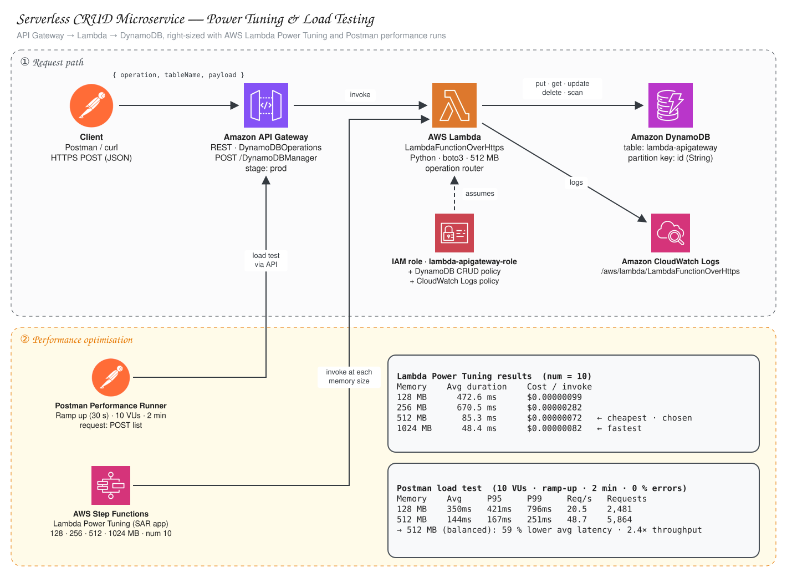
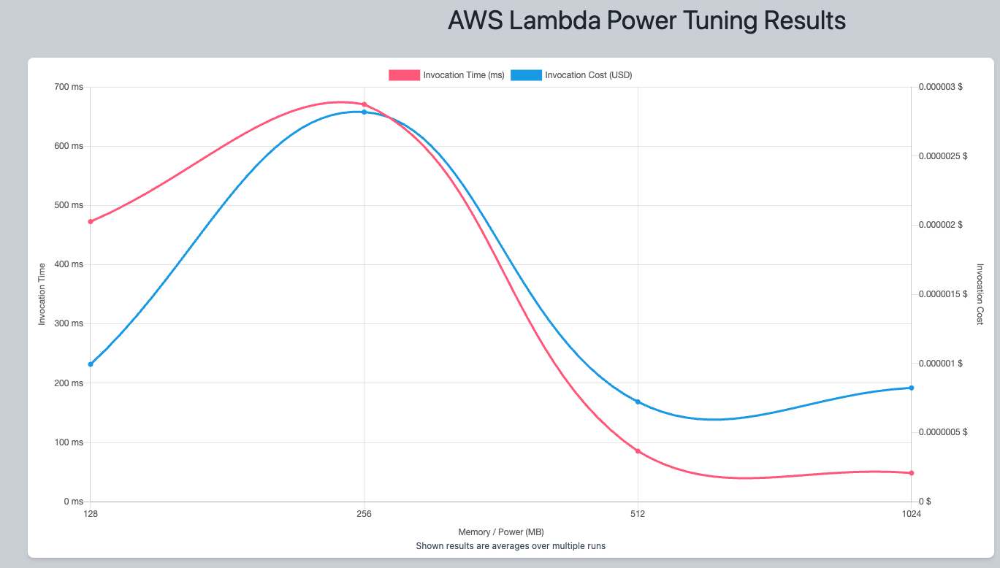
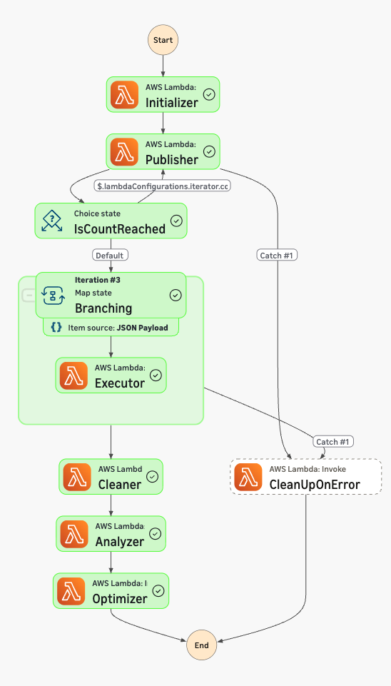
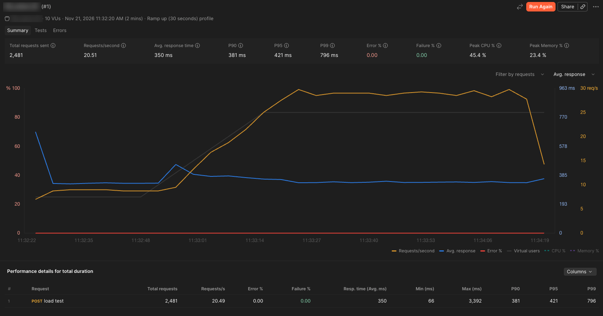
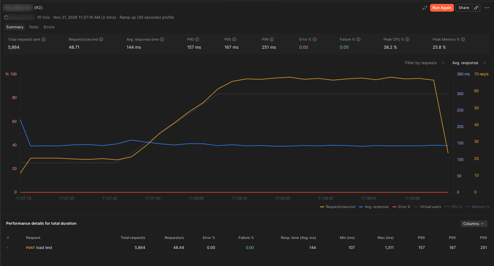
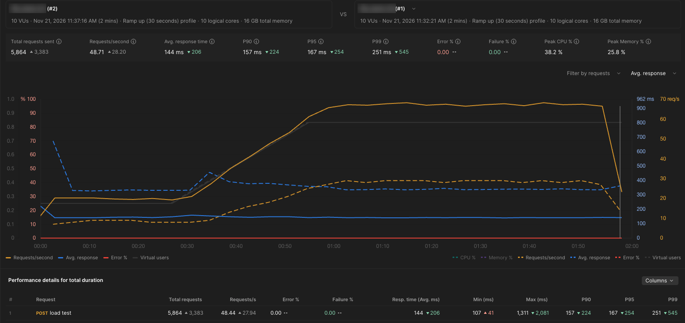

# Serverless CRUD Microservice: Lambda Power Tuning & Load Testing

A serverless REST microservice on AWS (**API Gateway → Lambda → DynamoDB**) that I tuned using **AWS Lambda Power Tuning** and load-tested with the **Postman Performance Runner**.

Power Tuning showed **512 MB** as the best cost/performance balance. Moving from **128 MB to 512 MB** cut average latency by **59 %** (350 ms → 144 ms) and P99 latency by **68 %** (796 ms → 251 ms). Throughput went up **2.4×** (20.5 → 48.7 req/s), with **0 % errors** in both runs.



> The editable source is [`diagrams/architecture.excalidraw`](diagrams/architecture.excalidraw). Open it at [excalidraw.com](https://excalidraw.com) with **Open → choose file**.

---

## What's in this repo

```
.
├── README.md
├── cloudformation/
│   ├── template.yaml              # Whole stack as code (IAM, Lambda, DynamoDB, API GW, Power Tuning)
│   ├── deploy.sh / destroy.sh     # One-command deploy and teardown
│   ├── run-power-tuning.sh        # Starts a tuning run and prints the visualization link
│   └── README.md
├── docs/
│   └── step-by-step-guide.md      # Full console walkthrough (IAM → Lambda → DynamoDB → API GW → tuning → load test)
├── lambda/
│   └── lambda_function.py         # CRUD handler (create/read/update/delete/list/echo/ping)
├── iam/
│   ├── dynamodb-crud-policy.json  # Custom policy: DynamoDB item CRUD
│   ├── cloudwatch-logs-policy.json# Custom policy: create log group/stream, put log events
│   └── lambda-trust-policy.json   # Trust policy so Lambda can assume the role
├── events/                        # Sample request bodies for every operation
├── postman/
│   ├── 00_load_test_v22.postman_collection.json # The exact collection used for the load tests
│   └── serverless-crud.postman_collection.json # All CRUD operations
├── power-tuning/
│   ├── state-machine-input.json   # Input for the Power Tuning state machine
│   ├── results.json               # Power Tuning output (decoded from the visualization link)
│   └── load-test-results.json     # Postman performance-run numbers
├── scripts/
│   ├── invoke-examples.sh         # curl every operation against your API
│   ├── generate_diagram.py        # Regenerates the .excalidraw + .svg diagram
│   └── generate_cfn.py            # Re-inlines lambda_function.py into the CloudFormation template
├── diagrams/                      # architecture.excalidraw / .svg / .png
└── images/                        # Power Tuning chart, state machine + Postman screenshots
```

## Architecture

| Layer | Resource | Notes |
|---|---|---|
| Entry point | **API Gateway (REST)** `DynamoDBOperations` | Resource `/DynamoDBManager`, method `POST`, stage `prod` |
| Compute | **Lambda** `LambdaFunctionOverHttps` | Python, routes on the `operation` field |
| Data | **DynamoDB** `lambda-apigateway` | Partition key `id` (String) |
| Security | **IAM role** `lambda-apigateway-role` | Two custom policies: DynamoDB CRUD and CloudWatch Logs |
| Observability | **CloudWatch Logs** | `/aws/lambda/LambdaFunctionOverHttps` |
| Optimisation | **Step Functions**: Lambda Power Tuning (SAR) | Benchmarks 128 / 256 / 512 / 1024 MB |
| Load testing | **Postman** Performance Runner | 10 virtual users, 30 s ramp-up, 2 min |

### Request contract

```json
{
  "operation": "create | read | update | delete | list | echo | ping",
  "tableName": "lambda-apigateway",
  "payload":   { "...": "arguments passed to the boto3 Table call" }
}
```

See [`events/`](events) for a ready-to-send body for each operation.

## Results

### 1. AWS Lambda Power Tuning (strategy: `cost`, `num: 10`, payload: `list`)

| Memory | Avg duration | Cost / invocation | |
|---:|---:|---:|---|
| 128 MB | 472.6 ms | $0.00000099 | |
| 256 MB | 670.5 ms | $0.00000282 | outlier, see note |
| **512 MB** | **85.3 ms** | **$0.00000072** | ✅ cheapest |
| **1024 MB** | **48.4 ms** | $0.00000082 | ⚡ fastest |



🔗 [Interactive visualization](https://lambda-power-tuning.show/#gAAAAQACAAQ=;EVHsQ1WdJ0TXo6pCya9BQg==;h1GFNU8gPTbz6kE14PlcNQ==)

<details>
<summary>Power Tuning state machine execution (Step Functions)</summary>



**Initializer** → **Publisher** (publishes a version/alias per memory value, looping until `IsCountReached`) → **Branching** map → **Executor** (invokes each alias `num` times) → **Cleaner** (removes the temporary versions/aliases) → **Analyzer** (picks the optimum for the chosen strategy) → **Optimizer**. On any failure, **CleanUpOnError** runs.
</details>

**Takeaways**
- More memory also means more CPU: Lambda allocates CPU in proportion to memory, reaching about 1 vCPU at 1,769 MB. A short, CPU- and network-bound function can finish so much faster that it costs **less** per call, even though each millisecond costs more.
- **512 MB** is the cheapest setting. It runs about **5.5× faster** than 128 MB and costs about 27 % less per call.
- **1024 MB** halves duration again (85 → 48 ms) for about **14 % more** cost per call than 512 MB.
- The **256 MB** result is slower than 128 MB, which isn't what you'd expect. With only 10 invocations per setting, cold starts can distort an average. Re-run with a higher `num`, such as 50–100, before relying on that point.

### 2. Postman load test (10 VUs · ramp-up 30 s · 2 min · `POST list`)

| Metric | 128 MB (run #1) | 512 MB (run #2) | Change |
|---|---:|---:|---:|
| Total requests | 2,481 | 5,864 | **+136 %** |
| Requests / sec | 20.51 | 48.71 | **2.4×** |
| Avg response | 350 ms | 144 ms | **−59 %** |
| P90 | 381 ms | 157 ms | −59 % |
| P95 | 421 ms | 167 ms | −60 % |
| P99 | 796 ms | 251 ms | **−68 %** |
| Max | 3,392 ms | 1,311 ms | −61 % |
| Error rate | 0 % | 0 % | — |

> Response times are measured end to end from the client. They include network, API Gateway and DynamoDB time, so they are higher than the Lambda-only durations from Power Tuning. The "Peak CPU / Memory" figures in Postman describe the machine running Postman, not Lambda.

| Run #1 · 128 MB | Run #2 · 512 MB |
|---|---|
|  |  |

**Side-by-side comparison**



### Recommendation: 512 MB (balanced)

| Option | Verdict |
|---|---|
| **512 MB** ✅ chosen | Cheapest per call in Power Tuning **and** a 59 % latency cut / 2.4× throughput under load: best balance |
| 1024 MB | Fastest in Power Tuning (48 ms vs 85 ms) but about 14 % more per call. Worth it only if latency is critical |
| 128 MB | Avoid: slowest under load, and costs more per call than 512 MB |

Memory is a **cost/performance dial**, not a fixed setting. Re-run Power Tuning whenever the code, payload size or traffic pattern changes. This maps to the *Performance Efficiency* and *Cost Optimization* pillars of the AWS Well-Architected Framework.

## Quick start

1. Create the resources, either:
   - **Infrastructure as code:** `cd cloudformation && ./deploy.sh` (see [`cloudformation/README.md`](cloudformation/README.md)), or
   - **By hand:** follow [`docs/step-by-step-guide.md`](docs/step-by-step-guide.md) in the AWS Console.
2. Call the API:
   ```bash
   export API_URL="https://<api-id>.execute-api.<region>.amazonaws.com/prod/DynamoDBManager"
   ./scripts/invoke-examples.sh
   ```
3. Or import a Postman collection and set its `api_url` variable:
   - [`postman/00_load_test_v22.postman_collection.json`](postman/00_load_test_v22.postman_collection.json): the single `POST list` request used for the load tests
   - [`postman/serverless-crud.postman_collection.json`](postman/serverless-crud.postman_collection.json): every operation

## Cleanup

If you deployed with CloudFormation, run `cloudformation/destroy.sh`. Otherwise, to avoid charges, delete the API Gateway API, the Lambda function, the DynamoDB table, the IAM role and policies, and the CloudFormation stack `serverlessrepo-aws-lambda-power-tuning`.

## References

- [alexcasalboni/aws-lambda-power-tuning](https://github.com/alexcasalboni/aws-lambda-power-tuning): the Power Tuning tool
- [Lambda memory and CPU](https://docs.aws.amazon.com/lambda/latest/dg/configuration-memory.html)
