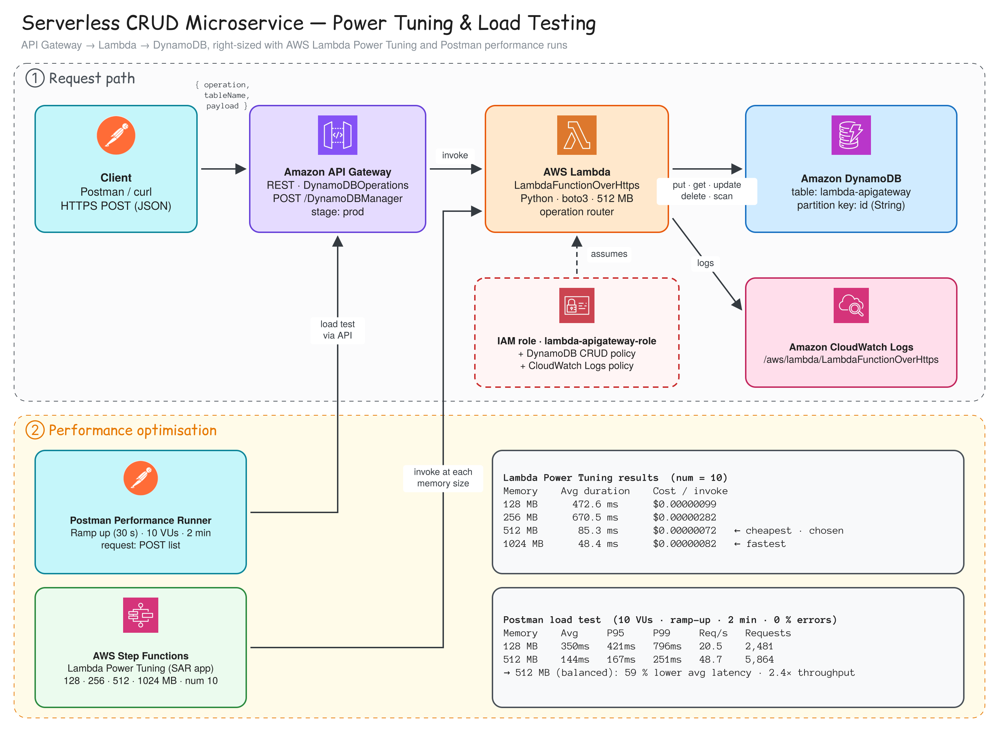
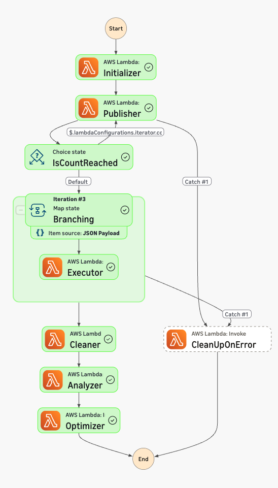
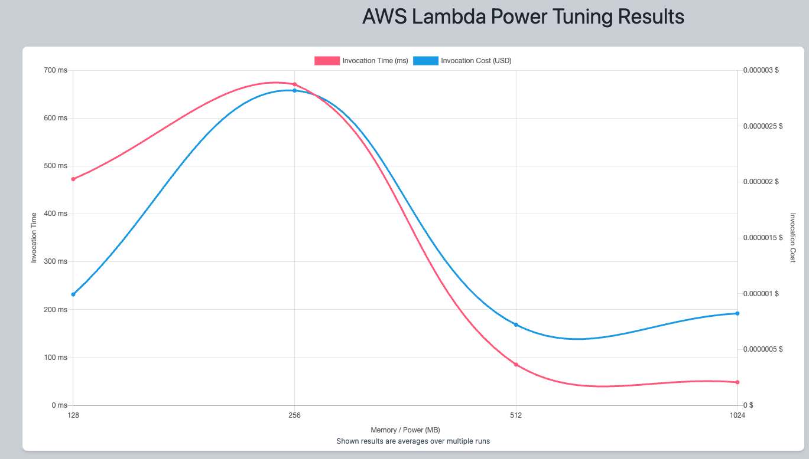
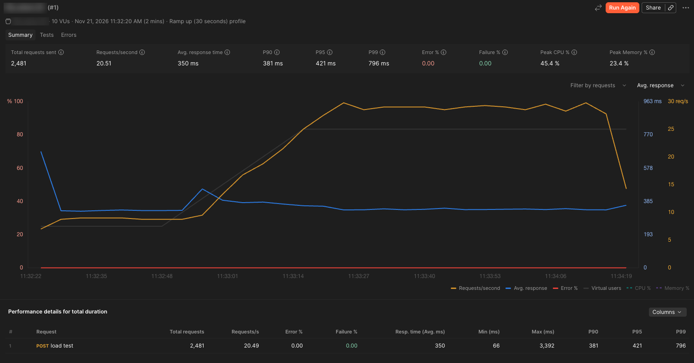
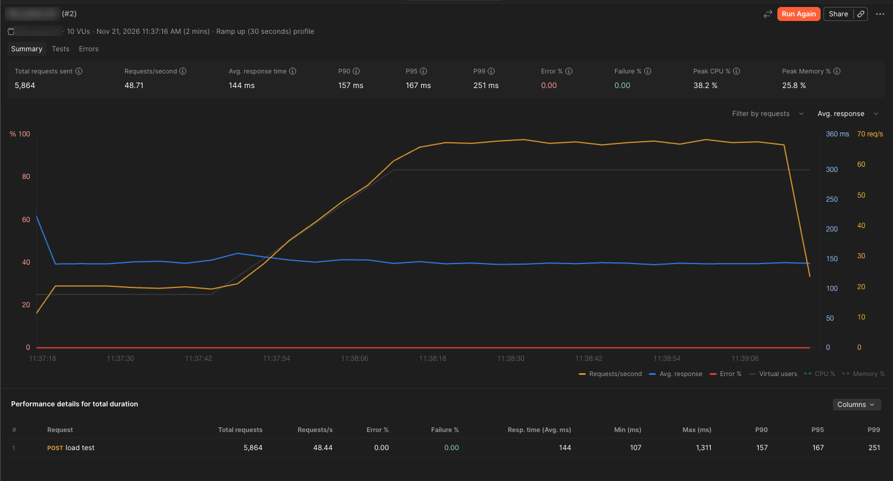
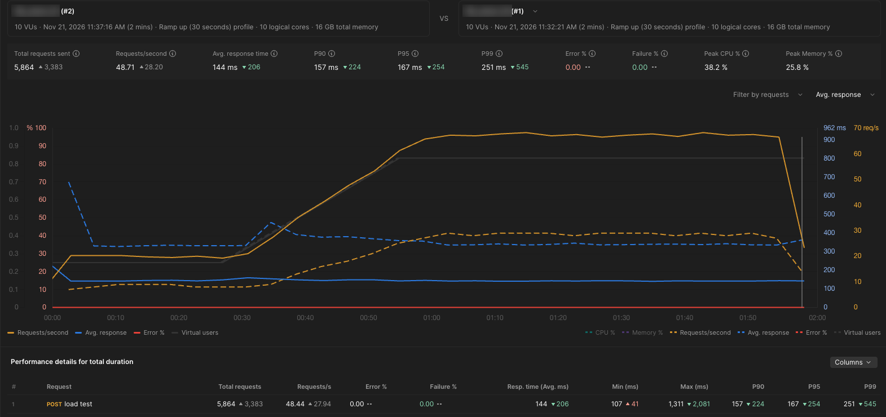

# Step-by-Step Guide

Build a serverless CRUD microservice (**API Gateway → Lambda → DynamoDB**), then right-size it with **Lambda Power Tuning** and **Postman load testing**. Everything is done in the AWS Console.

> Prefer infrastructure as code? [`cloudformation/`](../cloudformation) builds this whole setup with one command (`./deploy.sh`).



**Contents**
1. [Prerequisites](#0-prerequisites)
2. [Create the IAM policies](#1-create-the-iam-policies)
3. [Create the Lambda execution role](#2-create-the-lambda-execution-role)
4. [Create and test the Lambda function](#3-create-and-test-the-lambda-function)
5. [Create the DynamoDB table](#4-create-the-dynamodb-table)
6. [Create the API Gateway REST API](#5-create-the-api-gateway-rest-api)
7. [Deploy and test with Postman](#6-deploy-the-api-and-test-with-postman)
8. [Lambda Power Tuning](#7-lambda-power-tuning)
9. [Load testing with Postman](#8-load-testing-with-postman)
10. [Cleanup](#9-cleanup)

---

## 0. Prerequisites

- An AWS account, and an IAM user with console access (not the root user).
- The same AWS Region selected for every step.
- The [Postman desktop app](https://www.postman.com/downloads/), latest version. The Performance runner needs it.

## 1. Create the IAM policies

A policy only defines permissions. It does nothing until it is attached to a role, which we do in step 2.

### 1a. DynamoDB CRUD policy

1. **IAM → Policies → Create policy → JSON**.
2. Paste [`iam/dynamodb-crud-policy.json`](../iam/dynamodb-crud-policy.json) and replace `<REGION>` and `<ACCOUNT_ID>`.
   *(Scoping to the table ARN is least privilege. `"Resource": "*"` also works for a lab.)*
3. Name it `lambda-dynamodb-crud-policy` → **Create policy**.

Allowed actions: `PutItem`, `GetItem`, `UpdateItem`, `DeleteItem`, `Query`, `Scan`.

### 1b. CloudWatch Logs policy

1. **Create policy → JSON**, then paste [`iam/cloudwatch-logs-policy.json`](../iam/cloudwatch-logs-policy.json).
2. Name it `lambda-cloudwatch-logs-policy` → **Create policy**.

Allowed actions: `logs:CreateLogGroup`, `logs:CreateLogStream`, `logs:PutLogEvents`. These let the function write logs you can read in CloudWatch.

## 2. Create the Lambda execution role

1. **IAM → Roles → Create role**.
2. Trusted entity: **AWS service**, use case **Lambda**. This creates the trust policy in [`iam/lambda-trust-policy.json`](../iam/lambda-trust-policy.json).
3. Attach both policies from step 1.
4. Name it `lambda-apigateway-role` → **Create role**.

## 3. Create and test the Lambda function

1. **Lambda → Create function → Author from scratch**.
   - Name: `LambdaFunctionOverHttps`
   - Runtime: **Python 3.12** (or newer)
   - Execution role: **Use an existing role** → `lambda-apigateway-role`
2. Replace the default code with [`lambda/lambda_function.py`](../lambda/lambda_function.py) → **Deploy**.
3. **Test** tab → new event `echotest`, body from [`events/echo.json`](../events/echo.json) → **Test**.
   - Expected: the payload is returned unchanged. This proves the function and role work.
4. Optional: open **Monitor → View CloudWatch logs** to confirm the logging policy works.

> The handler reads `operation`, `tableName` and `payload`. It maps `create/read/update/delete/list` to boto3 `put_item/get_item/update_item/delete_item/scan`. `echo` and `ping` run without DynamoDB.

## 4. Create the DynamoDB table

1. **DynamoDB → Tables → Create table**.
   - Table name: `lambda-apigateway`
   - Partition key: `id` (**String**)
2. Leave the other defaults (on-demand capacity is fine) → **Create table**.

## 5. Create the API Gateway REST API

1. **API Gateway → Create API → REST API → Build**.
   - New API, name `DynamoDBOperations`, endpoint type **Regional** → **Create API**.
2. **Create resource** → name `DynamoDBManager` (path `/DynamoDBManager`).
3. Select the resource → **Create method**:
   - Method type: **POST**
   - Integration type: **Lambda function**
   - Lambda: `LambdaFunctionOverHttps` (same Region)
   - Leave *Lambda proxy integration* **off**. The function receives the JSON body as the event, and the handler also accepts proxy events.
   - **Create method**. API Gateway adds permission for itself to invoke the function.

## 6. Deploy the API and test with Postman

1. **Deploy API** → **New stage** → give it a name, for example `prod` → **Deploy**. *(My deployment used a stage named `Post`. Any name works, and it becomes part of the URL.)*
2. Copy the **Invoke URL** and add the resource path:
   ```
   https://<api-id>.execute-api.<region>.amazonaws.com/<stage>/DynamoDBManager
   ```
3. In Postman, import [`postman/serverless-crud.postman_collection.json`](../postman/serverless-crud.postman_collection.json) and set the collection variable `api_url` to that URL.
   *(Or create a request by hand: method **POST**, Body → raw → JSON.)*
4. Send **create** ([`events/create.json`](../events/create.json)):
   ```json
   { "operation": "create", "tableName": "lambda-apigateway",
     "payload": { "Item": { "id": "1234ABCD", "number": 5 } } }
   ```
   Check in **DynamoDB → Explore items** that the item now exists.
5. Send **list** ([`events/list.json`](../events/list.json)) to return all items. Try **read**, **update** and **delete** too.
6. From a terminal you can run everything at once:
   ```bash
   API_URL="<your url>" ./scripts/invoke-examples.sh
   ```

✅ The microservice works from end to end.

---

## 7. Lambda Power Tuning

[AWS Lambda Power Tuning](https://github.com/alexcasalboni/aws-lambda-power-tuning) is a Step Functions state machine. It runs your function at several memory sizes and charts cost against speed, so you can pick memory for your goal: cheapest, fastest or balanced.

### 7a. Deploy the tool

1. Open the **Serverless Application Repository** → **Available applications**.
2. Search `power`, and tick **Show apps that create custom IAM roles or resource policies**.
3. Open **aws-lambda-power-tuning**, keep the defaults, tick **I acknowledge that this app creates custom IAM roles** → **Deploy**.

### 7b. Run the state machine

1. **Step Functions → State machines → `powerTuningStateMachine…` → Start execution**.
2. Paste [`power-tuning/state-machine-input.json`](../power-tuning/state-machine-input.json), the exact input I used, and replace the ARN placeholders with your Region, account number and function name:
   ```json
   {
     "lambdaARN": "arn:aws:lambda:<region>:<user_np>:function:<lambda_function_name>",
     "powerValues": [128, 256, 512, 1024],
     "num": 10,
     "payload": {
       "operation": "list",
       "tableName": "lambda-apigateway",
       "payload": {}
     },
     "parallelInvocation": true,
     "strategy": "cost"
   }
   ```
3. Watch the execution graph. The state machine publishes a version per memory value, invokes each one `num` times, cleans up, then analyses the results:

   

   | State | What it does |
   |---|---|
   | Initializer / Publisher | Creates a Lambda version + alias for each value in `powerValues` (loops until `IsCountReached`) |
   | Branching → Executor | Invokes every alias `num` times (in parallel when `parallelInvocation` is true) |
   | Cleaner | Deletes the temporary versions/aliases |
   | Analyzer | Calculates average duration and cost, and picks the optimum for the `strategy` |
   | Optimizer | Applies the optimal memory only if `autoOptimize` is set; otherwise it does nothing |
   | CleanUpOnError | Runs only if a step fails |

4. When it finishes, open **Execution input and output**, copy the `visualization` URL, and open it in a browser.

### 7c. My results



[Open my visualization](https://lambda-power-tuning.show/#gAAAAQACAAQ=;EVHsQ1WdJ0TXo6pCya9BQg==;h1GFNU8gPTbz6kE14PlcNQ==)

| Memory | Avg duration | Cost / invocation |
|---:|---:|---:|
| 128 MB | 472.6 ms | $0.00000099 |
| 256 MB | 670.5 ms | $0.00000282 |
| 512 MB | 85.3 ms | **$0.00000072** (cheapest) |
| 1024 MB | **48.4 ms** (fastest) | $0.00000082 |

Lambda allocates CPU in proportion to memory, reaching about 1 vCPU at 1,769 MB. So 512 MB is both faster **and** cheaper than 128 MB. The 256 MB point looks like cold-start noise from the small sample (`num: 10`). Raise `num` to confirm it.

## 8. Load testing with Postman

Power Tuning measures only the Lambda function. A Postman load test measures the whole path (client → API Gateway → Lambda → DynamoDB), and it works for any HTTP service, serverless or not.

### 8a. Baseline run at 128 MB

1. Make sure the function is at **128 MB** (**Configuration → General configuration**).
2. Import [`postman/00_load_test_v22.postman_collection.json`](../postman/00_load_test_v22.postman_collection.json), the collection I used, and set its `api_url` variable to your endpoint.
3. Open the collection's **⋯ → Run**. *Run lives on the collection, not on the individual request.*
4. Select the `load test` request, which sends `POST` with the `list` body.
5. Choose **Performance** → Load profile **Ramp up** → **10** virtual users → duration **2 mins** → **Run**.
6. When it finishes, export the report (**⋯ → Download PDF**) and note the average response time.

Result: **350 ms avg**, P99 796 ms, 20.5 req/s, 0 % errors.



### 8b. Re-run at 512 MB (balanced setting)

Power Tuning showed 512 MB as the cheapest setting and close to the fastest, so it is the balanced choice.

1. **Lambda → Configuration → General configuration → Edit**: Memory **512 MB** → **Save**. Optionally raise the timeout from the 3 s default to give headroom.
2. In Postman, click **Run Again** with the same profile.

Result: **144 ms avg**, P99 251 ms, 48.7 req/s, 0 % errors.



### 8c. Compare

Use **Compare runs** in Postman:



| | 128 MB | 512 MB | Change |
|---|---:|---:|---:|
| Avg response | 350 ms | 144 ms | **−59 %** |
| P95 | 421 ms | 167 ms | −60 % |
| P99 | 796 ms | 251 ms | **−68 %** |
| Throughput | 20.5 req/s | 48.7 req/s | **2.4×** |
| Total requests (2 min) | 2,481 | 5,864 | +136 % |
| Errors | 0 % | 0 % | — |

With 10 virtual users sending back to back, lower latency directly increases throughput. The same users completed 2.4× more requests.

## 9. Cleanup

Delete these to avoid ongoing charges:

1. **API Gateway**: `DynamoDBOperations`
2. **Lambda**: `LambdaFunctionOverHttps`
3. **DynamoDB**: `lambda-apigateway`
4. **CloudFormation**: the stack `serverlessrepo-aws-lambda-power-tuning`, which removes the state machine and its roles
5. **IAM**: `lambda-apigateway-role` and the two custom policies
6. **CloudWatch Logs**: `/aws/lambda/LambdaFunctionOverHttps` (optional)
